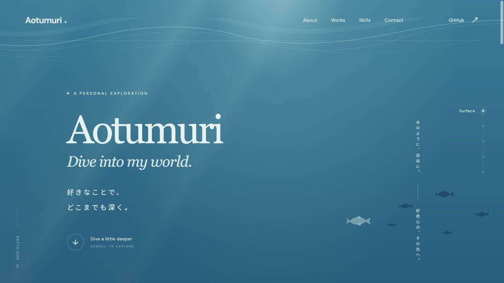
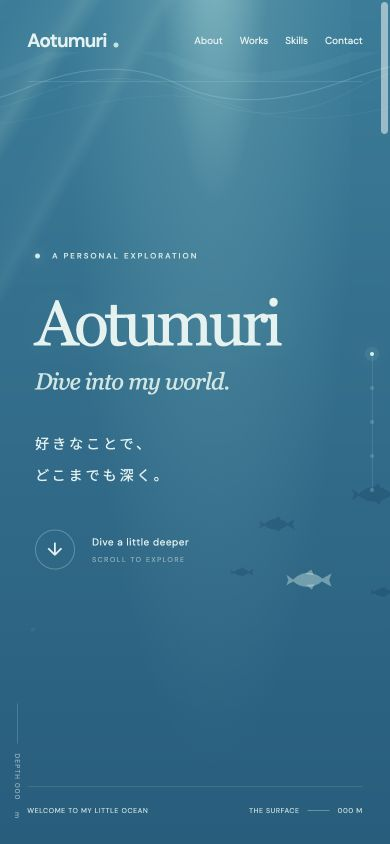

# 検証記録

実施日：2026年10月18日（日本時間）。

## 確認済み

- `npm install`：依存関係を取得し、package-lock.jsonを生成。取得時の監査結果は脆弱性0件。
- `npm run build`：TypeScriptチェックとViteの本番ビルドが成功。
- `BASE_PATH=/Aotumuri-site/ npm run build`：サブディレクトリ用の本番ビルドが成功。
- `/Aotumuri-site/secret.html`：表示、リンクからの遷移、再読み込みが成功。
- `/Aotumuri-site/404.html` と未知の入れ子パス：専用404画面と水面への復帰が動作。
- 提供されたロゴSVGと配置したSVGのSHA-256が一致。コントローラーJSも元ファイルをそのまま配置。
- ロゴの再生ボタン：既存ロゴを表示。Escapeによるスキップ、背景のinert解除、再生ボタンへのフォーカス復帰を確認。
- セクションへの移動、現在セクションの表示、水深メーターが動作。ラベルの水深とメーターを一致させて補間。
- HOMEの魚：クリックでメッセージが表示。
- Konami Code：キー列から特別な演出と通知が表示。
- 宝箱：Enterで開き、aria-expandedとメッセージが変化。
- 連絡先：設定されたGitHubのみ表示され、未設定のDiscord・メールは非表示。
- 画面幅1280、768、390、320pxで確認。確認画面で横スクロールなし。390pxの制作物は縦並び、320pxの連絡先も収まる。
- タブレットで発見したクラゲと見出しの重なりを修正し、再確認。
- 確認したブラウザーコンソールの警告・エラーなし。

## 2026年10月29日の再確認

- `npm run build`：TypeScriptチェックと標準の本番ビルドが成功。
- `npm audit`：脆弱性0件。
- サブディレクトリ用ビルド後、`npm run preview -- --base /Aotumuri-site/` でページ、秘密ページ、favicon、JS、CSSのHTTP応答を確認。

検証環境のブラウザーは `prefers-reduced-motion: reduce` を返していました。初回のロゴが自動再生されないこと、CSSアニメーションが `none`、スクロールが `auto`、出現アニメーション対象も不透明度1で閲覧できることを実際の計算済みスタイルで確認しました。再生ボタンでは既存ロゴの完成形を表示します。

## 未検証・公開時に必要なこと

- `no-preference` 環境での通常の浮遊アニメーション・ロゴの時間経過・初回のみ再生の実ブラウザー通し確認。実装と既存SVGのタイムラインは確認しましたが、今回のブラウザーは動きを減らす設定でした。
- Safari / Firefox / iOS / Android実機での表示。画面サイズ変更による確認は実機確認の代わりにはなりません。
- GitHub ActionsをGitHub上で実行する検証、および実際のGitHub Pages公開。開始時の作業フォルダーには `.git`・リモート設定がなく、コードのpushやリポジトリ作成はしていません。
- GitHub Pagesが返すHTTP 404ステータスと独自ドメインのDNS・HTTPS。ローカルViteのフォールバックでは、専用UIの表示と復帰リンクを検証しました。
- 制作物の仮原稿・実際のプロジェクトURL・追加連絡先の公開前確認。

## プレビュー

